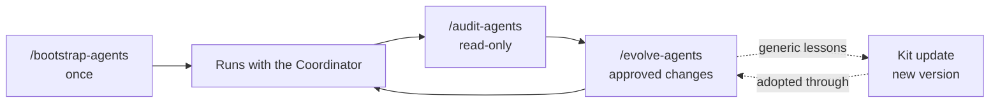

# Supervised DS agents

A versioned kit that sets up a team of VS Code Copilot agents for data science, machine learning, and data engineering repositories, under human supervision. Each stage of the work leaves a checkable record, an independent reviewer reads the results, and nothing changes in the agents' own setup without your approval.

Scope: data science, machine learning, deep learning, data engineering, data architecture, Python and SQL, and visualisation.

## Why

Coding agents produce plausible changes quickly. In data work, the costly mistakes are quiet: rows dropped in a join, leakage across a holdout boundary, a wrong denominator, a figure that no longer matches its data. Reading the final diff does not catch them.

The kit makes the work verifiable instead of trusted:

- **Fixed roles with single owners.** Nine roles (Coordinator, Data Steward, Researcher, Data Architect, Data Engineer, ML Engineer, Statistical Reviewer, Visualizer, Report Curator), each owning specific paths. See [ROLE_CATALOG.md](ROLE_CATALOG.md).
- **Handoff files and a ledger.** Every stage writes a JSON handoff: inputs, commands, checks and their results, output hashes, environment hash, unresolved items, lessons. The Coordinator records each one in a CSV ledger and gates the next stage on it.
- **Independent read-only review.** The Statistical Reviewer cannot edit anything; it traces claims to code, config, and results.
- **Private and reversible.** The agent workspace lives in `.github/`, excluded from your repository and versioned by its own local Git history, so any change can be undone.
- **Approval before change.** Bootstrapping, evolving the team, and adopting kit updates all propose first and apply only what you approve.

## Requirements

- VS Code with GitHub Copilot Chat (agent mode and custom agents).
- Git, conda, and an environment with Python 3.10 or later (3.11 or later for the optional portable-docs exporter).
- Developed and tested on Windows with PowerShell. Other platforms are untested.

The kit never installs packages.

## Quickstart

1. Clone the kit and install the slash commands into your VS Code user prompts folder, with the kit's location filled in:

   ```powershell
   git clone https://github.com/AIBUTT/supervised-ds-agents.git
   cd supervised-ds-agents
   conda run -n <env> python tools/kit_render.py install-prompts
   ```

   `/bootstrap-agents`, `/evolve-agents`, and `/audit-agents` then appear in Chat in every workspace. They run only when typed. Use `--dest <folder>` for a non-default VS Code profile, and `--overwrite` after moving the kit.

2. Open a data repository in VS Code: an empty folder or an existing repository with no uncommitted changes. Repositories that commit files under `.github/` (for example CI workflows) are refused; see [ARCHITECTURE.md](ARCHITECTURE.md#known-limitations).
3. Type `/bootstrap-agents` in Chat. It runs pre-flight checks, interviews you (empty folder) or inventories the repository, proposes a roster and settings, and renders only after your approval.
4. Select the **Coordinator** agent and describe the work. It plans the stages, delegates to the other roles, and gates each handoff.
5. Use `/audit-agents` for a read-only health check at any time, and `/evolve-agents` to change the team based on evidence from your runs.

## Lifecycle



## Documentation

| Document | Content |
| --- | --- |
| [ARCHITECTURE.md](ARCHITECTURE.md) | Kit layout, lifecycle, empty and existing repositories, safety layers, environments, undo, limitations |
| [ROLE_CATALOG.md](ROLE_CATALOG.md) | The nine roles, models, ownership, and when to include each |
| [components/portable_docs/README.md](components/portable_docs/README.md) | Optional offline report exporter and its adoption |
| [CHANGELOG.md](CHANGELOG.md) | Kit versions and the lessons each one adopted |

## Changing the kit

With this kit open as the workspace, `/evolve-kit` runs the Kit Maintainer agent through [prompts/evolve-kit.md](prompts/evolve-kit.md). It reads installed repositories you name as evidence (read-only), proposes generic changes with their version impact, applies only approved items, and verifies them with the kit tests and a temporary render. The command lives in this kit's `.github/prompts/`, so it appears only in this workspace.

By hand:

1. Change templates, prompts, or the skeleton.
2. Run the tests from the kit root: `conda run -n <env> python -m pytest -q -p no:cacheprovider tests`.
3. Record the change under `Unreleased` in `CHANGELOG.md`; update `kit_version` in `kit.json` when releasing.
4. Commit and tag (`git tag -a v<version>`) only after explicit approval.

Before adding a lesson from a repository, remove project names, paths, data descriptions, and anything confidential.

## License

[MIT](LICENSE)
